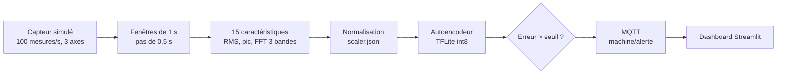

# Détection d'anomalies sur des vibrations (TinyML)

> **Version 1 : simulation sur PC.** Le capteur est simulé par du code. La version 2 portera le même pipeline sur une carte ESP32 avec un vrai accéléromètre MPU6050.

Un modèle léger apprend à reconnaître un fonctionnement **normal** et lance une alerte dès que le signal s'en écarte. Il n'a pas besoin de connaître les pannes à l'avance : il repère seulement ce qui ne ressemble pas au normal.


## Architecture



1. **Données** : un accéléromètre (type MPU6050) est simulé à 100 Hz. L'axe z mesure la gravité (≈ 9,81 m/s²).
2. **Caractéristiques** : par fenêtre de 1 s et par axe, on calcule le RMS, le pic et l'énergie FFT dans 3 bandes (0–10, 10–25, 25–50 Hz), soit 15 valeurs. Elles sont normalisées avec la moyenne et l'écart-type du jeu d'entraînement uniquement.
3. **Modèle** : un autoencodeur 15 → 12 → 8 → 4 → 8 → 12 → 15, entraîné sur du signal normal seulement. Une fenêtre anormale est mal reconstruite : l'erreur dépasse le seuil.
4. **Seuil** : 99ᵉ percentile de l'erreur sur des données normales de validation.
5. **Allègement** : conversion en TensorFlow Lite avec quantification 8 bits.
6. **Carte simulée** : un script lit le CSV à 100 Hz comme un capteur, applique la chaîne complète et publie l'état sur MQTT (Mosquitto).
7. **Dashboard** : une page Streamlit s'abonne à MQTT et affiche le signal, l'erreur, le seuil et les pannes détectées.

## Données simulées

| Fichier | Contenu |
|---|---|
| `normal_train.csv` | 10 min de fonctionnement normal (entraînement) |
| `test_mixed.csv` | 2 min avec 3 anomalies de 5 s |

Anomalies insérées dans le jeu de test :

- **A (20–25 s)** : vibration forte, amplitude environ 8 fois plus grande.
- **B (50–55 s)** : changement de fréquence, de 5 Hz à 18 Hz (comme un roulement qui s'use).
- **C (80–85 s)** : chocs ponctuels toutes les 0,4 s.

La colonne `label` (0 = normal, 1 = anormal) sert uniquement à évaluer les résultats : le modèle ne la voit jamais à l'entraînement.

## Résultats

Évaluation sur `test_mixed.csv` : 239 fenêtres, dont 27 anormales.

| Modèle | Précision | Rappel | F1 | Fausses alertes | Anomalies ratées |
|---|---|---|---|---|---|
| Isolation Forest (référence) | 0,77 | 1,00 | 0,87 | 8 | 0 |
| **Autoencodeur (Keras)** | 0,71 à 0,73 | 1,00 | 0,83 à 0,84 | 10 à 11 | 0 |
| **Autoencodeur (TFLite int8)** | identique au float32 | 1,00 | identique | identique | 0 |

Tailles du modèle (47,5 à 47,7 Ko selon la version de TensorFlow pour le fichier Keras) :

| Format | Taille |
|---|---|
| Keras (`.keras`) | 47,5 Ko |
| TFLite float32 | 5,8 Ko |
| TFLite int8 | 5,9 Ko |

- Les 3 anomalies sont détectées : aucune fenêtre anormale n'est ratée (rappel = 1,00).
- La quantification int8 ne change pas les performances de détection : mêmes décisions que le modèle float32 sur 100 % des fenêtres.
- L'entraînement n'est pas strictement identique d'une machine à l'autre : les scores de l'autoencodeur varient légèrement (F1 entre 0,83 et 0,84 sur nos essais).
- Le gain de taille (47,5 Ko → 5,9 Ko) vient surtout du format TensorFlow Lite. Le modèle étant très petit, la quantification 8 bits n'apporte presque rien en taille ici.
- Sur ce jeu simulé, l'Isolation Forest fait légèrement mieux que l'autoencodeur (F1 0,87 contre 0,84).
- Les fausses alertes sont isolées (1 fenêtre), alors qu'une vraie panne couvre environ 10 fenêtres consécutives.

## Installation

Prérequis : Python 3.10 à 3.12 et un broker MQTT [Mosquitto](https://mosquitto.org/download/) sur `localhost:1883`.

```bash
pip install -r requirements.txt
```

Sous Windows, si l'installation de TensorFlow échoue à cause des chemins longs, créez l'environnement virtuel dans un dossier court :

```bash
python -m venv C:\tf
C:\tf\Scripts\activate
```

## Utilisation

Ordre des scripts :

```bash
python generate_data.py          # crée data/normal_train.csv et data/test_mixed.csv
python plot_data.py              # signal_test.png (zones anormales en rouge)
python extract_features.py       # caractéristiques + data/scaler.json
python train.py                  # Isolation Forest, autoencodeur, seuil, évaluation
python quantize.py               # modèle TFLite int8 + seuil recalculé
```

Démarrage de la démo (Mosquitto doit tourner) :

```bash
# terminal 1
python -m streamlit run dashboard.py

# terminal 2
python simulate_board.py --vitesse 1     # 1 = temps réel, 10 = dix fois plus vite
```

Option `--sans-mqtt` : affichage dans le terminal uniquement, sans broker.

## Structure du dépôt

```
data/                 données générées (non versionné, recréé par les scripts)
model/                modèles Keras / TFLite et seuils (non versionné)
docs/                 captures d'écran et vidéo
features.py           calcul des caractéristiques (partagé entre entraînement et simulateur)
generate_data.py      simulation de l'accéléromètre
plot_data.py          tracé du signal de test
extract_features.py   fenêtres, normalisation, scaler.json
train.py              entraînement et évaluation
quantize.py           conversion TFLite int8
simulate_board.py     simulation de la carte (lecture CSV, inférence, MQTT)
ecoute_mqtt.py        abonné MQTT minimal pour tester sans dashboard
dashboard.py          dashboard Streamlit
requirements.txt      bibliothèques Python
```

`features.py` est le seul endroit où les caractéristiques sont calculées : l'entraînement et le simulateur l'importent, donc ils ne peuvent pas diverger.

## Limites

- Les données sont **simulées** : les résultats ne disent rien de la performance sur un vrai moteur.
- Le jeu de test ne contient que 3 anomalies, donc peu de fenêtres anormales (27) : les scores sont à prendre comme une démonstration.
- Le simulateur sur PC n'a pas de contraintes de mémoire ni de temps de calcul comme une vraie carte.

## Version 2 (prévue)

- Acquisition avec un vrai MPU6050 branché sur une ESP32.
- Réentraînement sur des mesures réelles.
- Calcul des caractéristiques, normalisation (`scaler.json`) et inférence sur la carte, alertes publiées en Wi-Fi.
